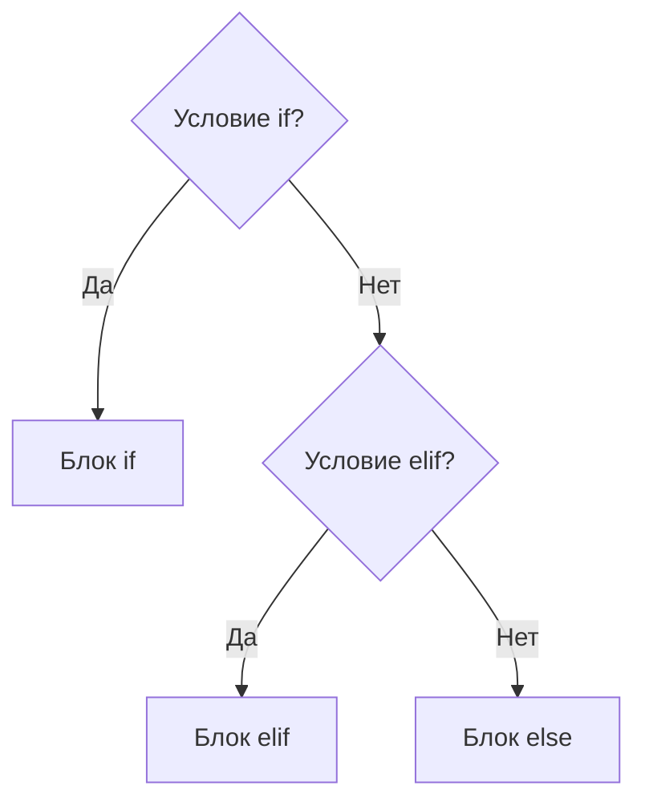
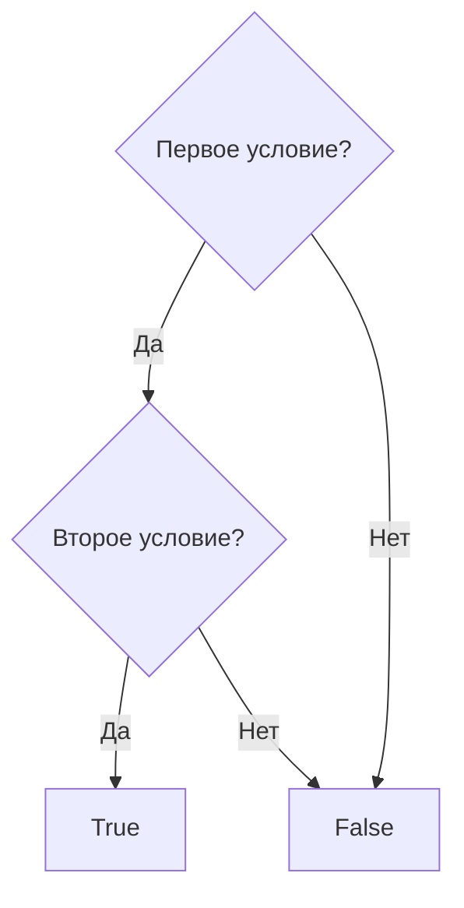

# Условия в Python: if, elif, else и логические операторы

**Оглавление:**
1. [Краткая выжимка](#краткая-выжимка)
2. [Что нужно знать заранее](#что-нужно-знать-заранее)
3. [Логические выражения и if](#3-логические-выражения-и-if)
4. [elif, else и порядок веток](#4-elif-else-и-порядок-веток)
5. [and, or, not](#5-and-or-not)
6. [Вложенные условия](#6-вложенные-условия)
7. [Справочник](#7-справочник)
8. [Типичные ошибки](#8-типичные-ошибки)
9. [Практика](#9-практика)
10. [Проверь себя](#10-проверь-себя)
11. [Словарь терминов](#11-словарь-терминов)
12. [Что дальше](#12-что-дальше)

---

## Краткая выжимка

* **bool** — тип с двумя значениями: `True` и `False`
* Сравнения `>`, `<`, `>=`, `<=`, `==`, `!=` дают `True` или `False`
* **if** выполняет блок, только когда условие истинно
* **elif** проверяется после ложных веток, **else** — когда не подошло ни одно условие
* **and** требует оба условия, **or** — хотя бы одно, **not** переворачивает
* Порядок веток `elif` важен: срабатывает первая истинная

## Что нужно знать заранее

Понадобятся числа, строки и `input()` из статьи [«Начало»](001_Python_Начало.md): `input()` возвращает строку, а `int()` превращает её в число. Не помнишь, как работает `input()`? Вернись к [001](001_Python_Начало.md) — это 10 минут.

```python
age = int(input("Сколько тебе лет? "))
print(age >= 10)
```

```text
Сколько тебе лет? 12
True
```

## 3. Логические выражения и if

Логическое выражение — вопрос с двумя ответами: `True` (истина) или `False` (ложь). Их тип — **bool**. Сравнения: `>` больше, `<` меньше, `>=` и `<=` — с равенством, `==` равно, `!=` не равно.

```python
temperature = 25
print(temperature > 20)
if temperature > 20:
    print("Тепло")
```
```text
True
Тепло
```

`if` — «если условие истинно, выполни блок»: после условия двоеточие, блок — с отступом 4 пробела. При `temperature = 15` строка «Тепло» пропустится: отступ — часть синтаксиса, а не оформление.

## 4. elif, else и порядок веток

`elif` (else if) проверяется, только если предыдущие условия ложны; `else` срабатывает, когда не подошло ни одно. Python выполняет ровно одну ветку — первую истинную.



```python
score = 85
if score >= 90:
    print("Отлично")
elif score >= 70:
    print("Хорошо")
else:
    print("Нужно подучить")
```
```text
Хорошо
```

Порядок важен: `85 >= 70` истинно, поэтому до `else` очередь не дошла. Поставь мягкое условие первым — и отличник со `score = 95` получит «Хорошо». Ветки идут от строгого к мягкому, `else` — последним.

## 5. and, or, not

`and` истинно, только когда истинны оба условия; `or` — когда хотя бы одно; `not` переворачивает значение.



```python
age = 12
has_permission = True
day = "воскресенье"
if age >= 10 and has_permission:
    print("Игра разрешена")
print(day == "суббота" or day == "воскресенье")
print(not has_permission)
```

```text
Игра разрешена
True
False
```

`not has_permission` даёт `False`. Строки сравниваются целиком: если в слове «воскресенье» последняя буква латинская `e`, условие молча не сработает, хотя выглядит правильным. Такую опечатку Python не видит — проверяй похожие слова посимвольно.

## 6. Вложенные условия

Условие можно поставить внутри другого условия; внутренний блок получает ещё один отступ.

```python
age = 12
has_ticket = True
if age >= 10:
    if has_ticket:
        print("Проходи в кинотеатр!")
    else:
        print("Нужно купить билет.")
```

```text
Проходи в кинотеатр!
```

Сначала проверяется возраст, потом — билет. То же короче через `and`: `if age >= 10 and has_ticket:`. Глубже двух уровней вложенность читать трудно — лучше объединять условия.

## 7. Справочник

| Что | Как | Пример | Результат |
|---|---|---|---|
| Условие | `if условие:` | `if age >= 10:` | блок при `True` |
| Иначе если | `elif условие:` | `elif age >= 7:` | проверка следующей ветки |
| Иначе | `else:` | `else:` | когда все условия ложны |
| Сравнения | `>`, `<`, `>=`, `<=`, `==`, `!=` | `score > 60` | `True` или `False` |
| И | `and` | `age >= 10 and has_ticket` | оба условия истинны |
| Или | `or` | `day == "суббота" or day == "воскресенье"` | хотя бы одно истинно |
| Не | `not` | `not is_raining` | противоположное значение |

## 8. Типичные ошибки

**Присвоение вместо сравнения.** В условии нужно `==`, а `=` кладёт значение в переменную.
<!-- no-check -->
```python
age = 12
if age = 12:
    print("Тебе 12 лет")
```

```text
  File "main.py", line 2
    if age = 12:
       ^^^^^^^^
SyntaxError: invalid syntax. Maybe you meant '==' or ':=' instead of '='?
```
**Забыли двоеточие после условия.**
<!-- no-check -->
```python
age = 12
if age >= 10
    print("Можно")
```

```text
  File "main.py", line 2
    if age >= 10
                ^
SyntaxError: expected ':'
```
**Тело `if` без отступа.**
<!-- no-check -->
```python
age = 12
if age >= 10:
print("Можно")
```

```text
  File "main.py", line 3
    print("Можно")
    ^^^^^
IndentationError: expected an indented block after 'if' statement on line 2
```

## 9. Практика

**Разминка. Чётное число.** Спроси число и напечатай «чётное» или «нечётное». *Сделано, если* используются `%` и `else`, а при вводе `7` выводится «нечётное».

**Основное. Оценка по баллам.** По баллам от 0 до 100 выведи оценку по четырём диапазонам. *Сделано, если* ветки идут от строгого условия к мягкому. Готовая задача: [Оценка по баллам](../Задачки/04_01.md).

**Основное. Тип треугольника.** По трём сторонам определи, равносторонний треугольник, равнобедренный или разносторонний. *Сделано, если* используются `and` и `or`, а невозможный треугольник обрабатывается отдельно. Готовая задача: [Тип треугольника](../Задачки/05_01.md).

**Со звёздочкой. Мини-квест.** Спроси номер двери и выдай разные ответы для 1, 2 и остальных чисел. *Сделано, если* для ввода `1` вывод повторяет пример:
```text
Дверь 1
Ты нашёл клад!
```

## 10. Проверь себя

<details><summary>Что выведет <code>print(10 > 5 and 2 > 3)</code>?</summary>
<code>False</code>: второе условие ложно, а <code>and</code> требует оба <code>True</code>.</details>
<details><summary>Почему порядок веток <code>elif</code> важен?</summary>
Выполняется первая истинная ветка. Если мягкое условие стоит выше строгого, оно перехватит значения, которые должны были попасть ниже.</details>
<details><summary>Сколько веток выполнится, если истинны два условия подряд?</summary>
Одна: следующая за первой истинной уже не проверяется.</details>
<details><summary>Почему <code>"Суббота" == "суббота"</code> даёт <code>False</code>?</summary>
Python сравнивает символы, а регистр — часть символа: заглавная <code>С</code> не равна строчной <code>с</code>.</details>

## 11. Словарь терминов

| Термин | Что значит | По-английски |
|---|---|---|
| Условие | Выражение, дающее `True` или `False` | Condition |
| Логический тип | Тип с двумя значениями | Boolean |
| Ветвление и вложенность | Выбор блока по условию; условие внутри условия | Branching, nested condition |
| Отступ | Сдвиг блока вправо | Indentation |
| Логические операторы | `and`, `or`, `not` | Logical operators |

## 12. Что дальше

[Циклы в Python](003_Python_Циклы.md) — научимся повторять одни и те же действия много раз и перебирать числа через `for` и `while`.
