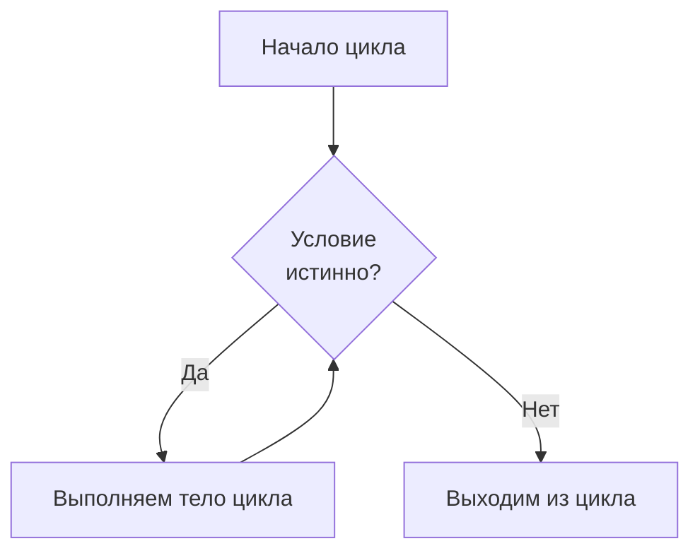
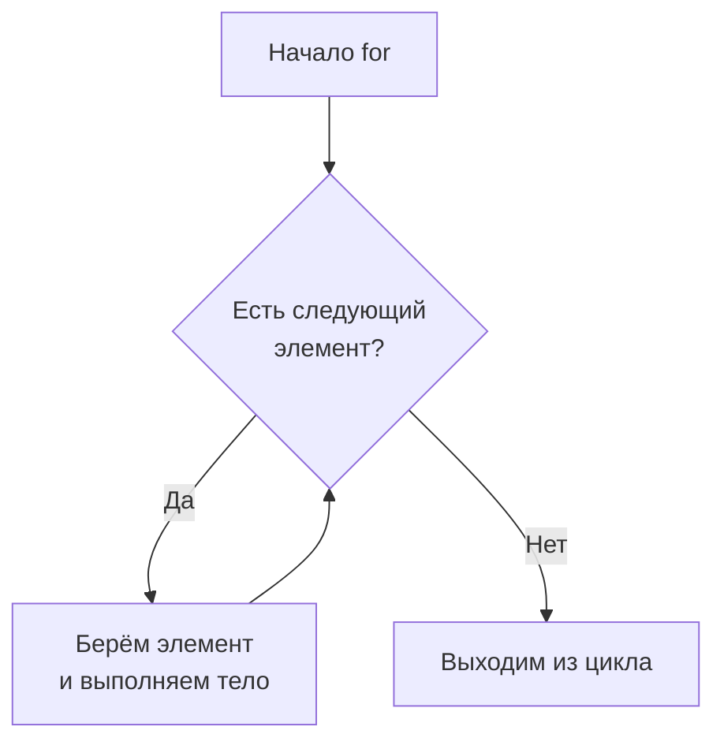

# Циклы в Python: повторяем действия много раз

**Оглавление:**
1. [Краткая выжимка](#краткая-выжимка)
2. [Что нужно знать заранее](#что-нужно-знать-заранее)
3. [Зачем нужен цикл](#3-зачем-нужен-цикл)
4. [Цикл while](#4-цикл-while)
5. [Счётчик и накопитель](#5-счётчик-и-накопитель)
6. [break и continue](#6-break-и-continue)
7. [Цикл for](#7-цикл-for)
8. [Функция range](#8-функция-range)
9. [Вложенные циклы](#9-вложенные-циклы)
10. [Справочник](#10-справочник)
11. [Типичные ошибки](#11-типичные-ошибки)
12. [Практика](#12-практика)
13. [Проверь себя](#13-проверь-себя)
14. [Словарь терминов](#14-словарь-терминов)
15. [Что дальше](#15-что-дальше)

---

## Краткая выжимка

* **while** повторяет код, пока условие истинно
* **for** повторяет код для каждого элемента последовательности
* **range(start, stop, step)** создаёт последовательность чисел, `stop` не включается
* **break** досрочно выходит из цикла
* **continue** пропускает остаток шага и переходит к следующему
* **Счётчик** считает проходы, **накопитель** собирает сумму или строку
* Внутри одного цикла может работать другой — это **вложенные циклы**

## Что нужно знать заранее

Понадобятся логические выражения и `if` из статьи [«Условия»](002_Python_Условия.md): условие — это выражение, которое даёт `True` или `False`, а блок под `if` выполняется, только когда условие истинно.

```python
score = 10
print(score > 5)     # True
if score > 5:
    print("много")   # сработает
```

Цикл устроен так же, просто проверка повторяется много раз.

> Не помнишь, что такое `True` и `False`? Вернись к [002](002_Python_Условия.md) — это 10 минут.

## 3. Зачем нужен цикл

Допустим, нужно напечатать «Я учу Python» сто раз. Копировать строку сто раз — плохая идея: легко ошибиться, а исправлять придётся все сто строк. **Цикл** — это конструкция, которая повторяет один и тот же код нужное число раз.



Тело цикла — код, который повторяется. Условие проверяется перед каждым проходом (такой проход называют **итерацией**).

## 4. Цикл while

`while` повторяет тело, пока условие остаётся истинным.

```python
count = 1
while count <= 5:
    print(f"Шаг {count}")
    count = count + 1

print("Цикл закончен")
```

```text
Шаг 1
Шаг 2
Шаг 3
Шаг 4
Шаг 5
Цикл закончен
```

Что произошло: Python проверил `count <= 5` — истина, напечатал «Шаг 1» и увеличил `count` до 2. Потом снова проверил условие и так далее. Когда `count` стал равен 6, условие дало `False`, и цикл завершился.

Главное правило `while`: **внутри тела должно что-то менять условие**. Если `count` не увеличивать, условие всегда истинно, и цикл никогда не закончится.

## 5. Счётчик и накопитель

Две схемы встречаются в каждой второй задаче.

**Счётчик** отвечает на вопрос «сколько раз?».

```python
count = 0
while count < 3:
    count += 1
print(f"Повторили {count} раза")
```

```text
Повторили 3 раза
```

Запись `count += 1` — то же самое, что `count = count + 1`, только короче. Так можно делать с любой переменной и любой операцией: `total -= 5`, `score *= 2`.

**Накопитель** собирает результат по кусочкам.

```python
total = 0
number = 1
while number <= 5:
    total = total + number
    number += 1
print(f"Сумма: {total}")
```

```text
Сумма: 15
```

Как менялись переменные:

| Шаг | number | total | Вывод |
|---|---|---|---|
| 1 | 1 | 1 | — |
| 2 | 2 | 3 | — |
| 3 | 3 | 6 | — |
| 4 | 4 | 10 | — |
| 5 | 5 | 15 | — |
| 6 | 6 | 15 | цикл остановился |

Накопитель обязательно нужно создать **до** цикла (`total = 0`), иначе на первом шаге Python скажет, что переменная не определена.

## 6. break и continue

`break` выходит из цикла немедленно. `continue` пропускает остаток текущего шага и переходит к следующей проверке.

**break** — ищем первое число, которое делится на 7:

```python
number = 1
while number <= 100:
    if number % 7 == 0:
        print(f"Нашли: {number}")
        break
    number += 1
print("Поиск завершён")
```

```text
Нашли: 7
Поиск завершён
```

**continue** — печатаем только нечётные числа:

```python
number = 0
while number < 6:
    number += 1          # сначала меняем счётчик
    if number % 2 == 0:
        continue         # чётные пропускаем
    print(number)
```

```text
1
3
5
```

Обратите внимание: `number += 1` стоит **до** `continue`. Если поставить его после, то на чётном числе `continue` перепрыгнет через увеличение, условие останется истинным, и цикл зациклится навсегда.

## 7. Цикл for

`for` перебирает элементы последовательности: строки, списка, `range`. Счётчик внутри `for` вести не нужно — Python сам переходит к следующему элементу.

```python
word = "кот"
for letter in word:
    print(f"Буква: {letter}")
```

```text
Буква: к
Буква: о
Буква: т
```



Что произошло: Python взял первую букву, выполнил тело, взял вторую и так далее, пока буквы не закончились. Переменная `letter` каждый раз получает новое значение.

## 8. Функция range

`range` создаёт последовательность чисел. Три варианта записи:

| Запись | Числа | Сколько |
|---|---|---|
| `range(5)` | 0, 1, 2, 3, 4 | 5 штук |
| `range(2, 5)` | 2, 3, 4 | 3 штуки |
| `range(10, 0, -3)` | 10, 7, 4, 1 | 4 штуки |

```python
for number in range(5):
    print(number, end=" ")
print()

for number in range(2, 5):
    print(number, end=" ")
print()

for number in range(10, 0, -3):
    print(number, end=" ")
```

```text
0 1 2 3 4 
2 3 4 
10 7 4 1 
```

`end=" "` говорит `print`, что вместо перевода строки в конце нужно поставить пробел. Поэтому числа печатаются в одну строку, а пустой `print()` после цикла возвращает перевод строки.

Главное про `range`: **правая граница не включается**. `range(5)` — это пять чисел, но последнее из них — 4, а не 5. Из-за этого почти всегда пишут `range(1, 11)`, когда нужны числа от 1 до 10.

## 9. Вложенные циклы

Циклы можно ставить друг в друга. На каждой итерации внешнего цикла внутренний выполняется целиком, с начала.

```python
for row in range(1, 4):
    for col in range(1, 4):
        print(row * col, end=" ")
    print()
```

```text
1 2 3 
2 4 6 
3 6 9 
```

Внешний цикл отвечает за строки (`row` = 1, 2, 3), внутренний — за столбцы. Для `row = 1` внутренний цикл печатает 1, 2, 3, затем `print()` переводит строку, и начинается следующая строка.

## 10. Справочник

| Что | Как | Пример | Результат |
|---|---|---|---|
| Цикл с условием | `while условие:` | `while n < 3:` | повторяет, пока истина |
| Цикл по элементам | `for x in последовательность:` | `for l in "кот":` | л = к, о, т |
| Числа по порядку | `range(stop)` | `range(4)` | 0 1 2 3 |
| Числа с границами | `range(start, stop)` | `range(2, 5)` | 2 3 4 |
| Числа с шагом | `range(start, stop, step)` | `range(10, 0, -3)` | 10 7 4 1 |
| Выйти из цикла | `break` | `if x == 0: break` | цикл завершается |
| Пропустить шаг | `continue` | `if x % 2: continue` | шаг пропускается |
| Прибавить и сохранить | `x += 1` | `total += n` | `x = x + 1` |

## 11. Типичные ошибки

**Забыли увеличить счётчик — цикл никогда не закончится.**

<!-- no-check -->
```python
count = 1
while count <= 5:
    print("Шаг", count)
    # count += 1 забыли
```

Программа не падает, а печатает «Шаг 1» бесконечно. Остановить можно `Ctrl + C` в консоли. Если программа «зависла» и повторяет одну и ту же строку — ищите, что должно менять условие.

**Забыли двоеточие после условия.**

<!-- no-check -->
```python
while count <= 5
    print(count)
```

```text
  File "main.py", line 1
    while count <= 5
                    ^
SyntaxError: expected ':'
```

Правильно: `while count <= 5:` — двоеточие обязательно и у `while`, и у `for`.

**Тело цикла без отступа.**

<!-- no-check -->
```python
number = 1
while number <= 3:
print(number)
```

```text
  File "main.py", line 3
    print(number)
    ^
IndentationError: expected an indented block after 'while' statement on line 2
```

Тело цикла пишется с отступом 4 пробела, как и тело `if`.

**Ошибка на единицу: правая граница `range` не включается.**

```python
for number in range(1, 5):
    print(number, end=" ")
```

```text
1 2 3 4 
```

Числа 5 здесь не будет: чтобы напечатать от 1 до 5, нужно `range(1, 6)`.

**`continue` стоит перед изменением счётчика.**

<!-- no-check -->
```python
number = 0
while number < 5:
    if number % 2 == 0:
        continue      # счётчик не увеличился
    number += 1
    print(number)
```

На первом же шаге `number` равно 0, условие чётности истинно, `continue` возвращает в начало — и так бесконечно. Порядок должен быть такой: сначала изменение, потом проверка и `continue`.

## 12. Практика

**Разминка. Числа от 1 до 10.**
Напечатайте числа от 1 до 10, каждое с новой строки.
*Сделано, если* вывод начинается с 1 и заканчивается 10, всего 10 строк.

**Основное. Сумма диапазона.**
Сложите все числа от 1 до 100 и напечатайте результат.
*Сделано, если* программа выводит `5050` и использует цикл, а не готовую формулу.
Похожая задача с проверкой: [Сумма чисел в диапазоне](../Задачки/09_01.md).

**Основное. Таблица умножения.**
Для числа `n = 7` напечатайте таблицу умножения от 1 до 10 в виде `7 × 3 = 21`.
*Сделано, если* все 10 строк выведены циклом, а не десятью `print`.

**Со звёздочкой. Красивые числа.**
Найдите все числа от 10 до 99, сумма цифр которых равна 9.
*Подсказка:* цифры числа — это `number // 10` и `number % 10`.
*Сделано, если* программа выводит все такие числа по возрастанию.
Похожая задача: [Красивые числа](../Задачки/10_01.md).

**Со звёздочкой. Угадай число с ограничением.**
Загадайте число, дайте игроку 5 попыток и после каждой подсказывайте «больше» или «меньше». После пятой попытки выведите, угадал он или нет.
*Сделано, если* программа делает не больше 5 попыток и не падает, если игрок угадал раньше (для этого нужен `break`).

## 13. Проверь себя

<details>
<summary>Сколько раз выполнится тело цикла <code>for i in range(4):</code>?</summary>
Четыре раза: i принимает значения 0, 1, 2 и 3.
</details>

<details>
<summary>Почему <code>while number &lt; 10:</code> без изменения <code>number</code> внутри тела не работает?</summary>
Условие всегда остаётся истинным, поэтому цикл повторяется бесконечно. Внутри тела (или внутри <code>if</code> в цикле) переменную из условия нужно менять.
</details>

<details>
<summary>Что выведет <code>for n in range(1, 6): print(n, end=" ")</code>?</summary>
<code>1 2 3 4 5</code>. Правая граница 6 не включается.
</details>

<details>
<summary>Чем <code>break</code> отличается от <code>continue</code>?</summary>
<code>break</code> завершает цикл целиком, <code>continue</code> только пропускает остаток текущего шага.
</details>

<details>
<summary>Что напечатает этот код?</summary>
<pre>total = 0
for n in range(1, 4):
    total += n
print(total)</pre>
<code>6</code>: 1 + 2 + 3.
</details>

## 14. Словарь терминов

| Термин | Что значит | По-английски |
|---|---|---|
| Цикл | Конструкция, которая повторяет код | Loop |
| Тело цикла | Код, который повторяется | Loop body |
| Итерация | Один проход тела цикла | Iteration |
| Счётчик | Переменная, считающая проходы | Counter |
| Накопитель | Переменная, собирающая результат | Accumulator |
| Бесконечный цикл | Цикл, который никогда не завершается | Infinite loop |
| Вложенный цикл | Цикл внутри другого цикла | Nested loop |

## 15. Что дальше

[Библиотека random](004_Python_Random.md) — научимся добавлять в программы случайность: броски кубика, случайный выбор и перемешивание.
