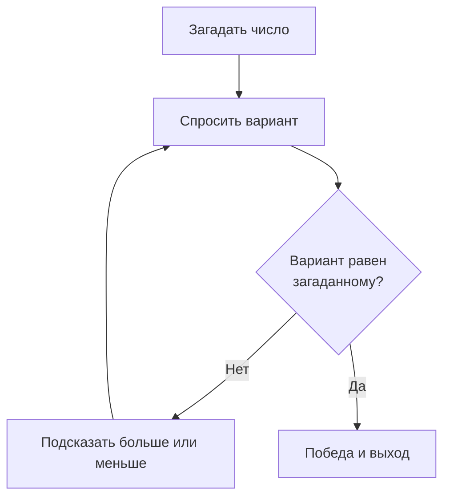

# Библиотека random: случайность в программах

**Оглавление:**
1. [Краткая выжимка](#краткая-выжимка)
2. [Что нужно знать заранее](#что-нужно-знать-заранее)
3. [Зачем нужна случайность и библиотека random](#3-зачем-нужна-случайность-и-библиотека-random)
4. [Случайные целые числа: randint и randrange](#4-случайные-целые-числа-randint-и-randrange)
5. [Выбор и перемешивание: choice, sample, shuffle](#5-выбор-и-перемешивание-choice-sample-shuffle)
6. [Дробные числа и seed](#6-дробные-числа-и-seed)
7. [Справочник](#7-справочник)
8. [Типичные ошибки](#8-типичные-ошибки)
9. [Практика](#9-практика)
10. [Проверь себя](#10-проверь-себя)
11. [Словарь терминов](#11-словарь-терминов)
12. [Что дальше](#12-что-дальше)

---

## Краткая выжимка

* **import random** подключает библиотеку случайных чисел
* **random.randint(a, b)** даёт целое от `a` до `b` включительно
* **random.randrange(...)** работает как `range`: правая граница не включается
* **random.choice(последовательность)** выбирает один элемент
* **random.sample(последовательность, k)** выбирает `k` разных элементов
* **random.shuffle(список)** перемешивает список на месте и возвращает `None`
* **random.seed(n)** делает последовательность чисел повторяемой

## Что нужно знать заранее

Понадобятся переменные, `print` и f-строки из статьи [«Начало»](001_Python_Начало.md), а ещё циклы `while` и `for` из статьи [«Циклы»](003_Python_Циклы.md). Списки в примерах — пока мини-справка: это значения в квадратных скобках, `[0]` — первый элемент, `[-1]` — последний, `append()` добавляет в конец; подробно — в статье [005](005_Python_List.md).

```python
fruits = ["яблоко", "банан"]
print(f"Первый: {fruits[0]}")   # Первый: яблоко
print(len(fruits))              # 2
fruits.append("киви")           # добавляет в конец
print(fruits[-1])               # киви
```

> Не помнишь циклы? Вернись к [003](003_Python_Циклы.md) — это 10 минут.

## 3. Зачем нужна случайность и библиотека random

Игры, лотереи, случайные вопросы теста и перемешанные варианты ответов — везде нужна **неопределённость**, а обычный код всегда даёт один и тот же результат. Python — базовый набор конструктора, а **библиотеки** — дополнительные коробки с деталями.

```python
import random

random.seed(7)                      # подробно в шаге 6: вывод станет повторяемым
dice = random.randint(1, 6)
print(f"На кубике выпало: {dice}")  # На кубике выпало: 3
```

`import random` подключает библиотеку, а обращение идёт через точку: `random.randint(...)` — «в библиотеке `random` возьми функцию `randint`». Так же устроена игра «Угадай число»: случайное число и цикл с подсказками — соберём её в практике.



## 4. Случайные целые числа: randint и randrange

`randint` включает обе границы, `randrange` устроен как `range` и правую границу не включает.

| Запись | Какие числа возможны |
|---|---|
| `random.randint(1, 6)` | 1, 2, 3, 4, 5, 6 |
| `random.randrange(1, 6)` | 1, 2, 3, 4, 5 |
| `random.randrange(0, 101, 10)` | 0, 10, 20, …, 100 |

```python
import random

random.seed(3)
print(random.randint(1, 6))          # 2
print(random.randint(1, 6))          # 5
print(random.randrange(1, 6))        # 5 — шестёрка не выпадет
print(random.randrange(0, 101, 10))  # 20
```

## 5. Выбор и перемешивание: choice, sample, shuffle

`choice` достаёт **один** элемент из списка или строки. `sample(последовательность, k)` — **k разных** элементов без повторов. `shuffle(список)` меняет порядок **на месте** и возвращает `None`.

```python
import random

random.seed(4)
fruits = ["яблоко", "банан", "апельсин", "виноград"]
print(random.choice(fruits))           # банан
print(random.sample(fruits, 2))        # ['апельсин', 'яблоко']
print(random.sample(range(1, 50), 6))  # [47, 26, 31, 10, 6, 5]

cards = ["туз", "король", "дама"]
random.shuffle(cards)
print(cards)                           # ['дама', 'король', 'туз']
```

Последний `sample` — готовый лотерейный билет. `shuffle` пригодится для перемешивания вариантов ответов; если исходный список должен остаться прежним, берите `random.sample(fruits, len(fruits))`.

## 6. Дробные числа и seed

`random.random()` возвращает дробное от 0.0 до 1.0 (1.0 не включается), `random.uniform(a, b)` — дробное в заданных границах. Через `random()` задают вероятность: число меньше 0.2 выпадает примерно в 20% случаев.

```python
import random

random.seed(42)
print(f"{random.random():.3f}")             # 0.639
print(f"{random.uniform(36.0, 37.5):.2f}")  # 36.04
random.seed(42)                             # сбросили seed
print(f"{random.random():.3f}")             # 0.639 — снова то же число
```

```text
0.639
36.04
0.639
```

Числа из `random` — **псевдослучайные**: их вычисляет генератор по начальному числу **seed**. Одинаковый seed даёт одинаковую последовательность, поэтому примеры повторяются. Без `seed` Python берёт начальное число из системного времени, и каждый запуск даёт новые значения. Для игр этого достаточно, а для паролей и шифрования нужен модуль `secrets`.

## 7. Справочник

| Что | Как | Пример | Результат |
|---|---|---|---|
| Целое включительно | `random.randint(a, b)` | `random.randint(1, 6)` | от 1 до 6 |
| Целое как в `range` | `random.randrange(start, stop, step)` | `random.randrange(0, 10, 2)` | 0, 2, 4, 6, 8 |
| Один элемент | `random.choice(последовательность)` | `random.choice("кот")` | к, о или т |
| Несколько разных | `random.sample(последовательность, k)` | `random.sample(range(1, 50), 6)` | 6 разных чисел |
| Перемешать на месте | `random.shuffle(список)` | `random.shuffle(cards)` | список изменён |
| Дробное в границах | `random.uniform(a, b)` | `random.uniform(1, 2)` | от 1.0 до 2.0 |
| Повторить вывод | `random.seed(n)` | `random.seed(42)` | последовательность та же |

## 8. Типичные ошибки

**Забыли импорт.** Правильно — `import random` первой строкой.
<!-- no-check -->
```python
number = random.randint(1, 6)
```

```text
Traceback (most recent call last):
  File "main.py", line 1, in <module>
    number = random.randint(1, 6)
             ^^^^^^
NameError: name 'random' is not defined. Did you forget to import 'random'?
```

**Перепутали границы `randint`.** Правильно — `random.randint(1, 10)`: сначала меньшее число.
<!-- no-check -->
```python
import random

value = random.randint(10, 1)
```

```text
Traceback (most recent call last):
  File "main.py", line 3, in <module>
    value = random.randint(10, 1)
ValueError: empty range in randint(10, 1)
```

**Тело `if` без отступа.** Правильно — сдвинуть `print` на 4 пробела.
<!-- no-check -->
```python
import random

if random.randint(1, 6) == 6:
print("Шестёрка!")
```

```text
  File "main.py", line 4
    print("Шестёрка!")
    ^^^^^
IndentationError: expected an indented block after 'if' statement on line 3
```

## 9. Практика

**Разминка. Пять бросков.** Бросьте кубик пять раз, напечатайте каждый результат и в конце — сколько раз выпала шестёрка. *Сделано, если* в выводе ровно 5 строк с числами от 1 до 6 и итог `Шестёрок: N`.

**Основное. Угадай число с пятью попытками.** Компьютер загадывает число от 1 до 100, у игрока 5 попыток. После каждой — подсказка «больше» или «меньше», после пятой — угадал игрок или нет. *Сделано, если* попыток не больше пяти и программа не падает при раннем угадывании.
Пример сессии:

```text
Я загадал число от 1 до 100. У тебя 5 попыток.
Попытка 1: 50
Больше
…
```

**Со звёздочкой. Угадай число наоборот.** Компьютер загадывает число и иногда врёт в подсказках. Условие и критерии — в задаче [«Угадай число наоборот»](../Задачки/007_1.md); для неё понадобятся функции из статьи [007](007_Python_функции.md).

## 10. Проверь себя

<details><summary>Может ли <code>random.randint(1, 6)</code> вернуть 6?</summary>
Да: <code>randint</code> включает обе границы, возможны все числа от 1 до 6.
</details>
<details><summary>Чем <code>random.randrange(1, 6)</code> отличается от <code>random.randint(1, 6)</code>?</summary>
<code>randrange</code> не включает правую границу и вернёт только 1–5.
</details>
<details><summary>Зачем нужен <code>random.seed()</code>?</summary>
Чтобы последовательность повторялась: одинаковый seed даёт одинаковый результат, это удобно для проверки программ.
</details>
<details><summary>Как получить шесть разных чисел от 1 до 49?</summary>
<code>random.sample(range(1, 50), 6)</code>: <code>randint</code> в цикле может повторить число, а <code>sample</code> — нет.
</details>

## 11. Словарь терминов

| Термин | Что значит | По-английски |
|---|---|---|
| Библиотека | Набор готовых функций, подключённый к программе | Library |
| Seed | Начальное число генератора случайных чисел | Seed |
| Псевдослучайное число | Число, вычисленное генератором по seed | Pseudorandom number |
| Перемешивание | Случайный порядок элементов | Shuffle |
| Выборка | Несколько разных элементов из последовательности | Sample |

## 12. Что дальше

[Списки](005_Python_List.md) — научимся хранить много значений в одной переменной, добавлять и удалять элементы и перебирать их с индексом.
