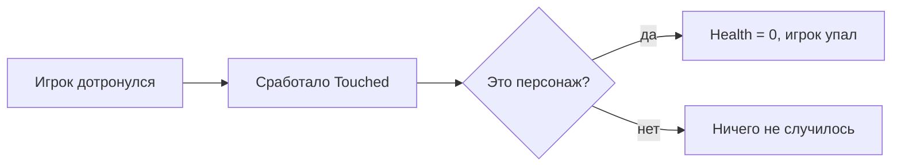

# Деталь-ловушка: скрипт, который убивает при касании

Представь: на карте стоит красная кнопка. Наступил на неё — и персонаж падает. В Roblox такую ловушку делают с помощью короткого скрипта. В нём всего 8 строк. Давай разберём его по кусочкам — как конструктор. 🤖

---

## 1. Вот весь скрипт

```lua
local part = script.Parent

part.Touched:Connect(function(hit)
	local character = hit.Parent
	local humanoid = character:FindFirstChild("Humanoid")

	if humanoid then
		humanoid.Health = 0
	end
end)
```

Не пугайся! Сейчас мы поймём каждую строчку, и скрипт станет совсем не страшным.

---

## 2. Куда его положить

1. Добавь на карту деталь: **Model → Part**.
2. Поставь галочку **Anchored**, чтобы деталь не падала.
3. Нажми правой кнопкой на деталь → **Insert Object → Script**.
4. Сотри всё, что написано в скрипте, и вставь код выше.
5. Нажми **Play** и дотронься до детали.

Всё получилось, если персонаж упал и через пару секунд снова появился на спавне.

---

## 3. Что делает каждая строчка

### `local part = script.Parent`

Скрипт лежит **внутри** детали. `script.Parent` — это «деталь, в которой я живу». Мы даём ей имя `part`, чтобы дальше к ней обращаться.

### `part.Touched:Connect(...)`

- `Touched` — это событие «кто-то дотронулся».
- `Connect` — «подключи»: сделай вот это, когда дотронутся.

Это как звонок в дверь. Кто-то нажал — и игра выполнила наш код.

### `function(hit)`

Когда кто-то касается детали, Roblox сам говорит нам: «вот тот, кто дотронулся». Это и есть `hit`. Обычно это рука или нога персонажа.

### `local character = hit.Parent`

У руки есть «родитель» — весь персонаж. Представь: рука — это часть тела, а `hit.Parent` — весь человечек.

### `character:FindFirstChild("Humanoid")`

Внутри персонажа есть **Humanoid** — «мозг» человечка. В нём хранится здоровье. Мы ищем этот «мозг».

Если деталь коснулся мяч или ящик, «мозга» у них нет — и мы просто ничего не делаем.

### `if humanoid then`

Это проверка: «если мозг нашёлся». Без неё игра выдаст ошибку, когда детали коснётся что-то неживое.

### `humanoid.Health = 0`

Здоровье стало `0` — значит, оно закончилось. Персонаж падает и через несколько секунд появляется на спавне.

---

## 4. Как это работает — по шагам



1. Игрок касается детали.
2. Срабатывает событие `Touched`.
3. Скрипт проверяет: это персонаж или нет?
4. Если персонаж — здоровье становится `0`, и игрок проигрывает.

---

## 5. Почему `Script`, а не `LocalScript`

Это очень важная вещь! 🤓

- **Script** — «главный повар на кухне». Он один на всех, работает на сервере. Его команды видят все игроки.
- **LocalScript** — «личная записка» у каждого игрока. Если такой скрипт обнулит здоровье, увидит это только сам игрок, а игра как будто и не заметит.

Поэтому смертельные ловушки делают обычным **Script**.

---

## 6. Три простых улучшения

### 6.1. Убивать только игроков, а не зомби

Сейчас ловушка убьёт любого, у кого есть «мозг» — даже зомби из твоей игры. Если это не нужно, добавим проверку:

```lua
local Players = game:GetService("Players")
local part = script.Parent

part.Touched:Connect(function(hit)
	local character = hit.Parent
	local humanoid = character:FindFirstChild("Humanoid")
	local player = Players:GetPlayerFromCharacter(character)

	if player and humanoid then
		humanoid.Health = 0
	end
end)
```

`GetPlayerFromCharacter` отвечает на вопрос: «это персонаж игрока?» Если да — убиваем, если нет — пропускаем.

### 6.2. Не убивать, а отнимать здоровье

Иногда нужно не убить сразу, а отнять немного здоровья, как шипы:

```lua
humanoid:TakeDamage(25)
```

Это отнимет 25 здоровья. А ещё `TakeDamage` не сработает, пока у игрока есть защитное поле после возрождения.

### 6.3. Чтобы не срабатывало сто раз подряд

`Touched` срабатывает **много раз**, пока персонаж трётся о деталь. Для урона это плохо: можно потерять всё здоровье за секунду. Сделаем «перезарядку»:

```lua
local canHit = true
local part = script.Parent

part.Touched:Connect(function(hit)
	local humanoid = hit.Parent:FindFirstChild("Humanoid")

	if humanoid and canHit then
		canHit = false
		humanoid:TakeDamage(25)
		task.wait(1)
		canHit = true
	end
end)
```

Пока идёт `task.wait(1)` (одна секунда), урон не повторяется. Это называется **debounce** — «защёлка».

---

## 7. Частые ошибки

| Что случилось | Почему | Что делать |
|---|---|---|
| Ничего не происходит | Скрипт — `LocalScript` или стоит галочка `Disabled` | Поставь обычный `Script` |
| Ошибка со словом `nil` | Нет проверки `if humanoid then` | Добавь проверку |
| Убивает мячики и зомби | Проверяется только «мозг» | Добавь `GetPlayerFromCharacter` |
| Деталь падает сквозь карту | Не включён `Anchored` | Поставь галочку `Anchored` |
| Здоровье тает слишком быстро | `Touched` срабатывает много раз | Добавь `debounce` |

---

## 8. Проверь себя

- [ ] Скрипт лежит **внутри** детали.
- [ ] Деталь закреплена (`Anchored`).
- [ ] Есть проверка `if humanoid then`.
- [ ] При касании персонаж падает.
- [ ] После возрождения ловушка снова работает.

Если все галочки на месте — ты сделал настоящую игровую механику! 🎉

---

## 9. Словарик

- **Скрипт** — инструкция для игры.
- **Событие** — «звоночек»: что-то случилось, игра сообщает.
- **Функция** — «поручение»: что именно надо сделать.
- **`nil`** — «пусто», ничего нет.
- **Сервер** — главный компьютер игры, он один на всех.

---

## 10. Куда идти дальше

- [Короткий разбор того же скрипта](../роблокс/01_touched_script.md)
- [Мини скриптики](<Мини скриптики.md>) — взрыв при касании и смена цвета.
- [Хилка](<Хилка.md>) — предмет, который лечит при касании.
- [Основы Lua](<001_Roblox_Начало.md>) — переменные, функции и таблицы.

---

**Главное:** даже 8 строк — это настоящая программа. В ней есть событие, проверка и команда. Понял её — сможешь сделать лечилку, телепорт, кнопку и любую другую механику в Roblox. 💪
